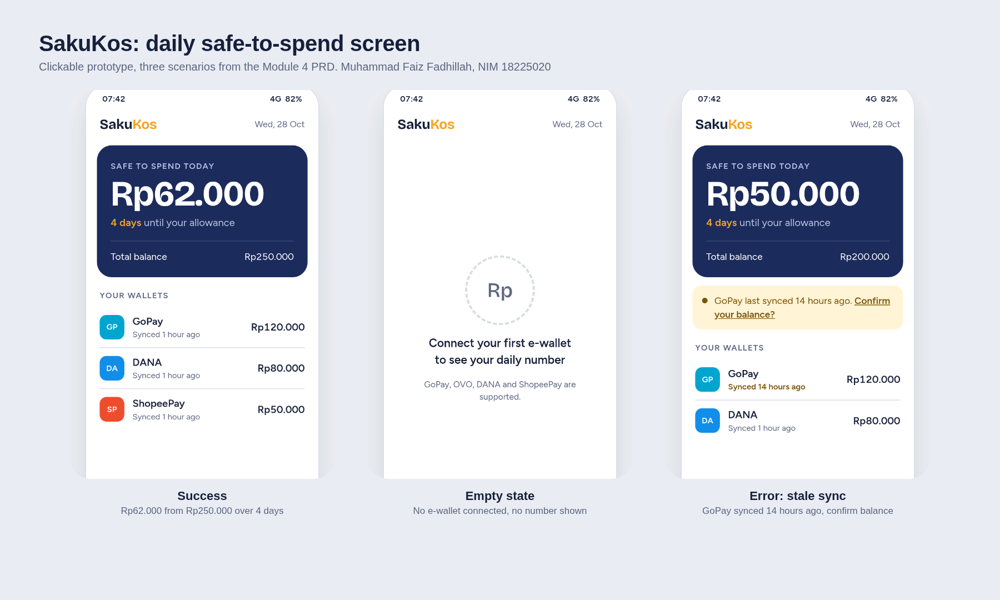

# SakuKos Prototype

Clickable prototype of the SakuKos daily safe-to-spend screen, built for the Product Management Hands On Module 5 (Muhammad Faiz Fadhillah, NIM 18225020).

SakuKos is a budgeting app for Indonesian students who live in a kos on a monthly allowance. The home screen shows one number: how much the student can spend today across all e-wallets.

Rule: safe to spend today = total e-wallet balance / days left until the next allowance (today included), rounded down to the nearest Rp1.000.



Live demo: https://seryu77.github.io/sakukos-prototype/

## Tech stack

React 19, TypeScript and Vite. No backend and no UI library. The calculation lives in `src/lib/safeToSpend.ts` and is covered by unit tests that use the numbers from the PRD.

## Run it

```bash
npm install
npm run dev
```

Other commands: `npm test` runs the calculation tests, `npm run build` makes the production build in `dist/`.

## Scenarios

Switch scenarios with the buttons next to the phone, or open one directly:

- `#success`: three wallets synced, number is Rp62.000
- `#empty`: no e-wallet connected, connect flow
- `#stale`: GoPay synced 14 hours ago, confirm balance sheet

## What is real and what is simulated

- Real: the calculation, the three screen states, the refresh rate limit countdown.
- Simulated: connecting a wallet, syncing balances, telemetry (the panel shows the payload, nothing is sent).
- Visual only: dates (28 Oct and 1 Nov 2026), status bar, wallet logos.
